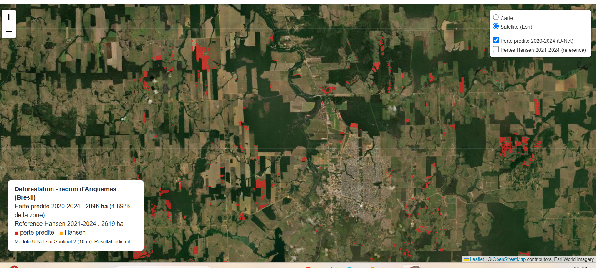
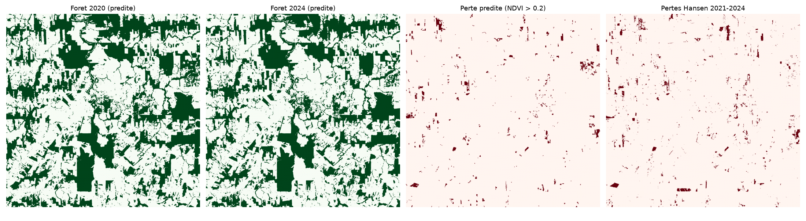
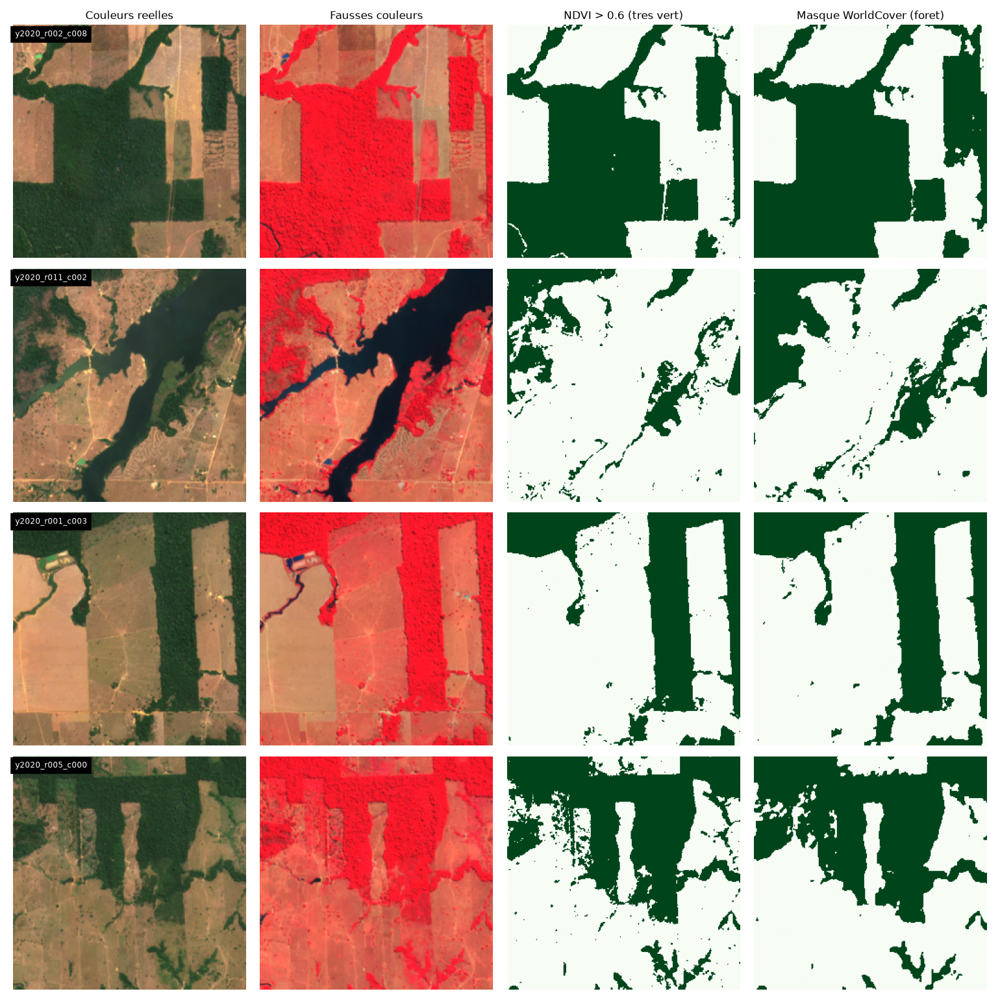
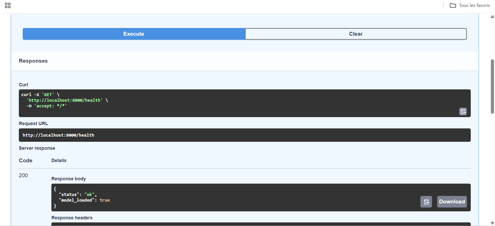
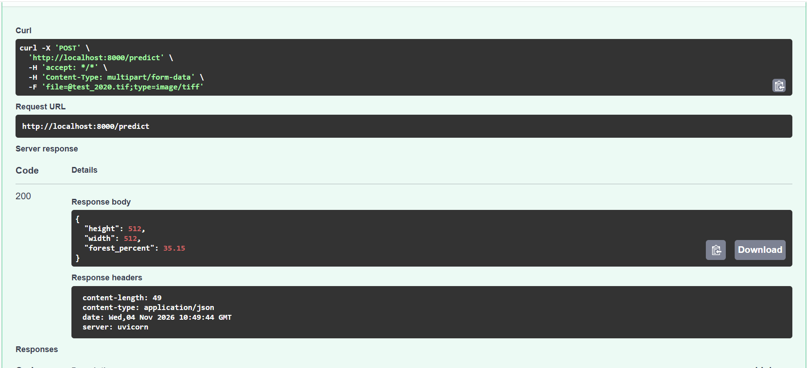

# deforestation-sentinel2 : surveillance de la déforestation par images satellites

Pipeline complet de détection de la perte de forêt entre **2020 et 2024** dans la région d'**Ariquemes (Rondônia, Brésil)** : segmentation **U-Net** sur images **Sentinel-2**, détection de changement validée face à une référence indépendante (Hansen), **carte interactive** et **API FastAPI dockerisée** avec tests.



## Résultats

| Étape | Résultat |
|---|---|
| Segmentation forêt / non-forêt, zone de test jamais vue | **IoU = 0,879** (validation : 0,913) |
| Forêt prédite sur toute la zone | 37,8 % en 2020, 35,8 % en 2024 |
| Perte prédite 2020-2024 (baisse de NDVI > 0,2) | **2 096 ha** (référence Hansen 2021-2024 : 2 619 ha) |
| Accord avec Hansen, pixel exact | précision 49,5 %, rappel 39,6 %, IoU 28,2 % |
| Accord avec Hansen, tolérance de 30 m | précision 65,7 %, rappel 52,9 % |

Le modèle retrouve les grandes parcelles déboisées mais détecte mal les petites pertes diffuses (voir *Limites*).



## Méthode

1. **Données** : composites médians Sentinel-2 (bandes B2, B3, B4, B8, 10 m) de la saison sèche (juin-septembre) 2020 et 2024, nuages masqués avec Cloud Score+, via Google Earth Engine. Zone d'environ 33 km x 33 km découpée en tuiles de 256 x 256 pixels.
2. **Étiquettes** : ESA WorldCover 2020 (classe « arbres », 10 m).
3. **Modèle** : U-Net, encodeur ResNet34 pré-entraîné (PyTorch, segmentation-models-pytorch), perte Dice + BCE, entrées normalisées par bande, entraînement sur CPU.
4. **Split par zone** (nord = entraînement, centre = validation, sud = test) pour éviter la fuite spatiale entre tuiles voisines.
5. **Changement** : perte = forêt prédite en 2020 **et** non-forêt prédit en 2024 **et** baisse du NDVI supérieure à un seuil, puis nettoyage morphologique (objets > 0,5 ha). Quatre seuils NDVI testés (0 / 0,1 / 0,2 / 0,3).
6. **Vérification indépendante** : comparaison avec les pertes Hansen 2021-2024 (Global Forest Change, version 2025), au pixel près et avec une tolérance de 30 m (résolution de Hansen).
7. **Livraison** : carte Folium, API FastAPI, tests pytest, image Docker.

## Validation des étiquettes (un point clé)

Le masque forestier Hansen, utilisé au départ pour entraîner le modèle, ne marquait que **2,4 %** de forêt alors que **34 %** des pixels étaient très verts (NDVI > 0,6) : inutilisable. Il a été remplacé par ESA WorldCover, qui couvre **95 %** des pixels très verts. Hansen est resté comme référence indépendante pour les pertes 2021-2024.



## Limites

- Une seule région et deux dates : rien ne prouve la généralisation à d'autres zones ou à d'autres années.
- Les étiquettes WorldCover sont une estimation, pas une vérité terrain : l'IoU de 0,88 mesure l'accord avec WorldCover.
- Hansen est à 30 m et couvre l'année complète, alors que les composites s'arrêtent en septembre.
- La détection par différence de deux classifications cumule leurs erreurs : l'IoU face à Hansen reste modeste (28 % au pixel près).
- Le seuil NDVI est choisi en comparant à Hansen : l'évaluation est donc un peu optimiste.
- Des arbres isolés sur pâturage peuvent produire de fausses alertes.

## Structure du dépôt

```
src/
  01_export_gee.py          export Sentinel-2 depuis Google Earth Engine
  02_tiling.py              découpage en tuiles 256 x 256
  03_explore.py, 05_check_mask.py   contrôles visuels et chiffrés des masques
  04_train.py               entraînement du U-Net (normalisation, seuil, métriques)
  06_export_worldcover.py   masque WorldCover 2020 et pertes Hansen 2021-2024
  07_change_detection.py    détection de changement et comparaison à Hansen
  08_diagnose_change.py     diagnostic de la détection de changement
  10_make_map.py            carte interactive (docs/map.html)
app/main.py                 API FastAPI
tests/test_api.py           tests pytest de l'API
models/norm.npz             normalisation et seuil (les poids .pth ne sont pas versionnés)
Dockerfile, requirements-api.txt
docs/                       carte et figures
```

## Utilisation

```powershell
python -m venv .venv
.venv\Scripts\Activate.ps1
pip install -r requirements.txt

python src\01_export_gee.py          # export Sentinel-2 (Earth Engine, usage non commercial)
python src\06_export_worldcover.py   # masque WorldCover + pertes Hansen
python src\02_tiling.py
python src\04_train.py
python src\07_change_detection.py
python src\10_make_map.py            # carte : docs/map.html
```

Les données (`data/`) et les poids du modèle (`models/unet_best.pth`) ne sont pas versionnés : les régénérer avec les commandes ci-dessus.

## API et Docker

| Route | Rôle |
|---|---|
| `GET /health` | état du service |
| `POST /predict` | pourcentage de forêt sur un GeoTIFF 4 bandes (B2, B3, B4, B8) |
| `POST /predict/mask` | masque de forêt au format PNG |
| `POST /change` | perte de forêt entre deux dates (estimation brute, sans nettoyage) |
| `GET /map` | carte interactive |

```powershell
python -m pytest                                  # 5 tests
uvicorn app.main:app --reload                     # en local : http://127.0.0.1:8000/docs

docker build -t deforestation-api .               # nécessite models/ et docs/map.html en local
docker run -p 8000:8000 deforestation-api
```




## Données et références

Copernicus Sentinel-2 (ESA) ; ESA WorldCover 2020 ; Hansen / UMD / Google / USGS / NASA, Global Forest Change. Vérifier les licences et les conditions de citation de chaque jeu de données avant toute réutilisation.

## Pistes d'amélioration

Augmentation de données et canal NDVI en entrée, plusieurs régions et années, entraînement sur les deux dates, évaluation par zone, nettoyage morphologique dans l'API.
